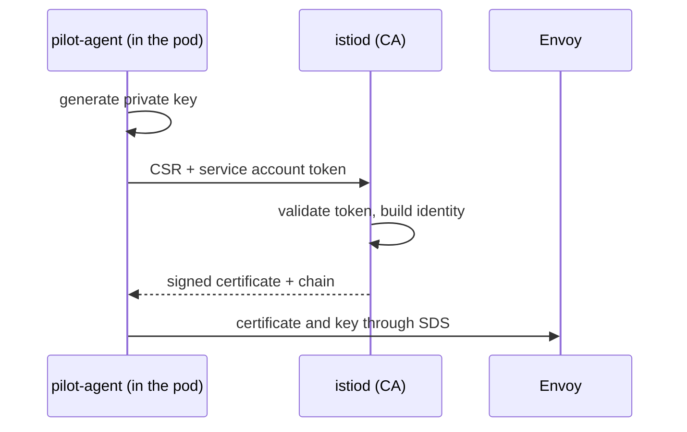

# The Certificate Authority In Istiod

Before you replace the CA, read what it does now. This chapter follows one workload certificate from request to use, then reads the certificate that the `probe` sidecar presents.

<!-- astrona:playground:renew -->

## How a workload gets a certificate

Each sidecar proxy contains a small agent, `pilot-agent`. When a pod starts, the agent generates a private key inside the pod and sends a certificate signing request (CSR) to `istiod`. The request is authenticated with the Kubernetes service account token of the pod. `istiod` checks the token, builds a certificate for the identity of that service account, signs it with the CA key, and returns it. The agent hands the certificate and key to Envoy, the proxy, through its secret discovery service (SDS). The private key never leaves the pod.

The identity inside the certificate is a SPIFFE ID, written as a URI in the Subject Alternative Name (SAN) field. For `probe` in `starfleet` it is `spiffe://cluster.local/ns/starfleet/sa/probe`. This is the identity that `principals` fields in authorization policies compare against.



## What a peer checks

When two sidecars open an mTLS connection, each presents its certificate and verifies the other's. The verifier checks four things: the chain ends in a root it trusts, every certificate in the chain is inside its validity period, the certificate may be used for TLS, and the identity in the SAN is the one it expects. Istio uses the identity for authorization. A `principals` rule in an `AuthorizationPolicy` compares against the SAN URI of the caller, without the `spiffe://` prefix.

Trust is therefore decided by the root. Two workloads can verify each other only if their certificates chain to a root that both of them trust. This is the property that a plug-in CA controls.

## Which CA signs

`istiod` looks for a CA key and certificate in a fixed place. If it finds a Secret named `cacerts` in `istio-system`, it signs with the key in that Secret. If there is no `cacerts`, `istiod` generates a self-signed root certificate and key at startup and signs with those. It stores them in a Secret named `istio-ca-secret`.

The public part of the root is distributed to every namespace in the ConfigMap `istio-ca-root-cert`. Proxies use it to verify the certificates of their peers.

```sh
kubectl get secret -n istio-system
kubectl get configmap istio-ca-root-cert -n starfleet
```

The first command lists `istio-ca-secret` and no `cacerts`. The second shows the root certificate ConfigMap of the namespace.

## Read a workload certificate

Run the helper and read the certificate that the `probe` sidecar presents:

```sh
chain
ls proxy-cert-*.pem
openssl x509 -in proxy-cert-1.pem -noout -subject -issuer -dates
openssl x509 -in proxy-cert-1.pem -noout -ext subjectAltName
```

The `-ext` option needs OpenSSL 1.1.1 or later. If your `openssl` is older, use `openssl x509 -in proxy-cert-1.pem -noout -text` and read the SAN line.

Read the output as follows:

- The SAN holds the URI `spiffe://cluster.local/ns/starfleet/sa/probe`.
- The issuer names the CA of `istiod`, not a company CA.
- The `notAfter` date is about 24 hours after `notBefore`. The next chapter explains the number.

The files `proxy-cert-2.pem` and any further file are the CA certificates that the sidecar sends along with its own, so that a peer can build the chain.

## Compare the trust anchor with the chain

The root that workloads trust is the content of the ConfigMap `istio-ca-root-cert`. Print its fingerprint and the fingerprint of the last certificate that the sidecar sent. When the sidecar sends the root, they match:

```sh
kubectl get configmap istio-ca-root-cert -n starfleet -o jsonpath='{.data.root-cert\.pem}' > trust-root.pem
openssl x509 -in trust-root.pem -noout -fingerprint -dates
```

The dates show the lifetime of the root itself. `istiod` sets the lifetime of its self-signed root with the variable `CITADEL_SELF_SIGNED_CA_CERT_TTL`, whose default is `87600h`, about ten years. A workload certificate lives for hours and the root for years, so the root is the long-term trust decision and the workload certificate is the short-term one.

## What changes with a plug-in CA

Nothing changes in the way a workload asks for a certificate. The agent still sends a CSR with a service account token, and `istiod` still builds the identity from it. Only two things differ: the key that signs, and the chain that the sidecar sends. With a plug-in CA the chain has the intermediate and the root in `cert-chain.pem`, so a peer that trusts your root can verify the workload certificate without any other configuration.

## Why replace it

The self-signed root is created by `istiod` and exists only in this cluster. Two problems follow. A second cluster has a different root, so workloads in the two clusters cannot verify each other. And the root key sits in a Secret in the cluster, so anyone who can read `istio-ca-secret` can mint certificates for any identity.

A plug-in CA addresses both. The root is created outside the cluster and can be shared across clusters. Only an intermediate CA key goes into the cluster, so the root key can stay offline. Replacing the CA is a decision about trust, so do it before workloads depend on the old root, because certificates from the old root stop being trusted by workloads that use the new one.

## Common pitfalls

> [!WARNING]
> - **Reading the identity from the subject.** The workload identity is in the SAN URI, not in the subject.
> - **Assuming the root changes with a restart.** `istiod` keeps its self-signed root until a `cacerts` Secret exists.
> - **Treating the self-signed root as secret-free.** Its key is a Secret in `istio-system`. Limit who can read it.
