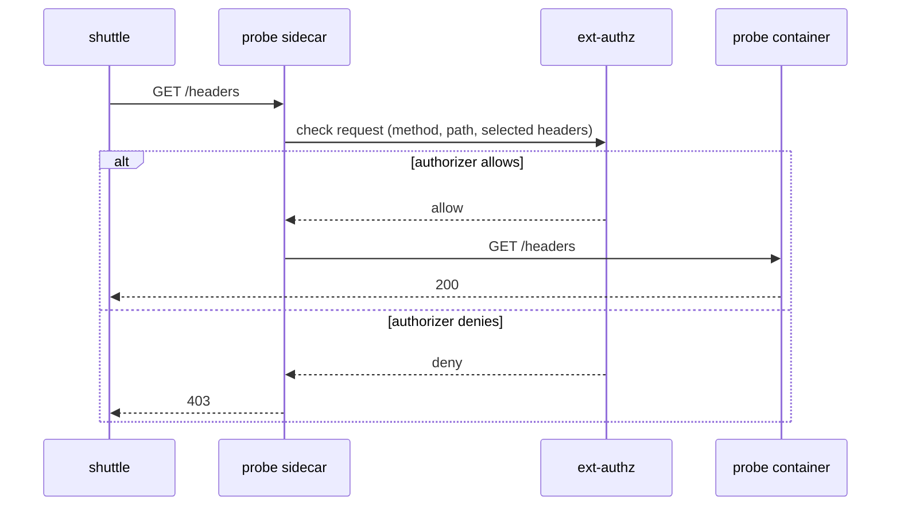

# Where The Decision Is Made

With `ALLOW` and `DENY`, the sidecar proxy decides alone. With `CUSTOM`, it hands the decision to another service. This chapter follows one request through that handoff, then starts the sample authorizer by itself so you can see what it answers before Istio is involved.

<!-- astrona:playground:renew -->

## The check request

The sidecar proxy in front of the protected workload runs a chain of HTTP filters. One of them is the external authorization filter (`ext_authz`). When a `CUSTOM` policy selects the workload and a request matches a rule of that policy, the filter does not forward the request yet. It sends a **check request** to the authorizer and waits.

The check request carries the method, the path, the host and a set of request headers. The provider definition decides which headers go along. The authorizer sends back an answer:

- **Allow.** The filter forwards the request to the workload. The authorizer may add headers that the filter copies onto the request.
- **Deny.** The filter ends the request and returns an error response to the caller. The workload never sees the request. The authorizer may set the status code, the response headers and the body of that response.

The authorizer is an ordinary service. Istio does not interpret its rules. The sample authorizer used here has one rule: allow only if the check request has the header `x-ext-authz: allow`. A production authorizer can read cookies, call a database or ask a policy engine.

## One request, step by step

The flow for a request that matches the `CUSTOM` rule:



The check runs in the sidecar of the **protected** workload, on the inbound side. The caller's sidecar does nothing special. Istiod (the Istio control plane) turns the `CUSTOM` policy into configuration for the sidecars of the pods the `selector` picks, and only those sidecars call the authorizer.

Every checked request waits for the authorizer, so the authorizer adds latency to every request that matches the rule. A slow or unreachable authorizer slows or blocks the workload. For that reason, keep the `CUSTOM` rule as narrow as the requirement allows. The provider also has a timeout.

## Two protocols for the check

Istio supports two ways to talk to the authorizer. Both appear as an **extension provider** in the mesh configuration, which is a named entry that says where the authorizer is and how to call it:

| Provider type | Protocol | Port in the sample |
| --- | --- | --- |
| `envoyExtAuthzHttp` | The proxy sends an HTTP request to the authorizer. A `2xx` answer allows, any other status denies | `8000` |
| `envoyExtAuthzGrpc` | The proxy calls the Envoy external authorization gRPC service | `9000` |

The HTTP type lets you choose which request headers are sent, with `includeRequestHeadersInCheck`. The sample authorizer reads `x-ext-authz`, so the header must be in that list or the authorizer never sees it.

## Where CUSTOM sits in the order

A workload can have policies with all three actions at the same time. Istio evaluates them in a fixed order: `CUSTOM` first, then `DENY`, then `ALLOW`. A `CUSTOM` policy that denies ends the request. A `CUSTOM` policy that allows does not end it: the `DENY` and `ALLOW` policies still run.

A `CUSTOM` policy matches requests in the same way as the other actions. A rule with `to.operation.paths: ["/headers"]` matches only requests for that path. Requests that match no rule do not go to the authorizer.

## Look at the authorizer alone

The playground deployed `ext-authz` already. Its pod has one container and no sidecar, because the label `sidecar.istio.io/inject: "false"` is set on the pod. Check it:

```sh
kubectl get pods,svc -n starfleet -l app=ext-authz
```

The pod shows `1/1`. The Service lists ports `8000` and `9000`.

The `probe` has no policy yet, so requests reach it with no check:

```sh
from_shuttle $PROBE/headers
from_shuttle $PROBE/ip
```

Both print `200`. The authorizer is deployed but nothing asks it anything. Nothing has asked the authorizer. Read its log:

```sh
kubectl logs -n starfleet deploy/ext-authz
```

No check request has arrived yet. Keep this command: once a `CUSTOM` policy exists, use it to see whether the authorizer was asked.

The sidecar will need two things to ask: the name of the provider and the address of the authorizer. Those go into the mesh configuration.

## Common pitfalls

> [!WARNING]
> - **Expecting the authorizer to be asked for every request.** Only requests that match a rule of the `CUSTOM` policy go to it.
> - **Forgetting the header list.** With an HTTP provider, a header the authorizer needs must be in `includeRequestHeadersInCheck`, or it is not sent.
> - **Reading the authorizer as part of the policy.** The policy only names a provider. The rules live in the authorizer, so a wrong answer is a bug in the authorizer, not in Istio.
